# In-Semester Evaluation (ISE 2) — MLOps & DevOps Submission Report

---

## 1. Problem Statement

### 1.1 Context & Background
In traditional educational institutions, identifying students at risk of academic underperformance often happens retrospectively—after final exams have already concluded. Timely, data-driven forecasting allows educators and counselors to deliver proactive interventions. However, operationalizing machine learning models into reliable, production-ready educational systems requires robust DevOps and MLOps practices. Without automated pipelines, machine learning applications suffer from environment configuration drift, manual deployment errors, untested code reaching production, and service downtime.

### 1.2 Proposed Problem Statement
> **"Design, containerize, and deploy an automated End-to-End DevOps Lifecycle for the Student Performance Prediction Web Application (`student-app`) on a Windows environment. The system integrates Python Flask for predictive inference and REST API services, Git for local version tracking, GitHub for collaborative source-code repository hosting, Docker for immutable containerization, and Jenkins for continuous integration, automated testing, container builds, and deployment verification."**

### 1.3 Key Objectives
1. **Application Layer**: Develop a responsive, lightweight Flask web application serving both an intuitive browser user interface (0–20 Portuguese secondary grading scale) and a RESTful `/predict` API backed by an scikit-learn regression pipeline trained on student demographic, social, and academic factors.
2. **Version Control & Collaboration**: Establish structured local version control with Git (semantic commits, branch protection) and synchronize code to a secure remote GitHub repository.
3. **Containerization**: Package the application runtime, Python dependencies, model artifacts, and static assets into an optimized, self-contained Docker image (`student-app:latest`) to guarantee identical behavior across Windows development machines and production hosts.
4. **Automated CI/CD Quality Gate**: Configure a declarative Jenkins CI/CD pipeline triggered by code pushes to automate dependency installation, code quality/linting checks, unit test execution via `pytest`, Docker image compilation, container rollout, and real-time `/health` check validation.
5. **Observability & Diagnostics**: Implement dedicated `/health` check endpoints and logging mechanisms to observe container state, build status, and runtime performance on Windows.

### 1.4 DevOps Lifecycle Architecture

```mermaid
flowchart LR
    subgraph Development [1. Development & Version Control]
        DEV[Developer / Windows PC] -->|Code & Test| FLASK[Python & Flask Web App]
        FLASK -->|Commit Changes| GIT[Git Version Control]
    end

    subgraph Hosting [2. Remote Source Hosting]
        GIT -->|git push origin main| GITHUB[GitHub Remote Repository]
    end

    subgraph Automation [3. Continuous Integration & Deployment]
        GITHUB -->|Webhook / Poll SCM| JENKINS[Jenkins Automation Server]
        JENKINS -->|Stage 1| CHK[Checkout Code]
        CHK -->|Stage 2| LINT[Dependency Lint & Compile]
        LINT -->|Stage 3| TEST[Automated Pytest Suite]
        TEST -->|Stage 4| DOCKER_BUILD[Docker Build Image]
        DOCKER_BUILD -->|Stage 5| DEPLOY[Deploy Container]
    end

    subgraph Production [4. Containerized Runtime]
        DEPLOY -->|docker run -p 5000:5000| APP_CONTAINER[student-app Container]
        APP_CONTAINER -->|GET /health| HEALTHCHECK[HTTP 200 Health Probe]
        APP_CONTAINER -->|HTTP 5000| USER[End-User / Web Browser]
    end
```



---

## 2. Tools: Environment Setup & Execution on Windows

---

### Tool 1: Python and Flask — Web Application Development

#### 1. Environment Setup
1. **Download & Install Python**:
   - Download the official Python 3.12 installer for Windows from [python.org](https://www.python.org).
   - **Crucial**: During installation, check the box **"Add python.exe to PATH"** to ensure global CLI availability.
2. **Virtual Environment & Dependencies**:
   - Create an isolated virtual environment (`.venv`) to isolate dependencies and prevent library version collisions.
   - Install Flask and runtime libraries (`pandas`, `scikit-learn`, `joblib`, `pytest`, `waitress`).

#### 2. Commands to Run on Windows (PowerShell / Command Prompt)

```powershell
# 1. Verify installed Python and pip versions
python --version
pip --version

# 2. Navigate to project root directory
cd "C:\Users\<YourUsername>\Downloads\MLOps ISE 2"

# 3. Create isolated virtual environment
python -m venv venv

# 4. Activate virtual environment
# In PowerShell:
.\venv\Scripts\Activate.ps1
# (If script execution policy blocks activation, run once: Set-ExecutionPolicy -ExecutionPolicy RemoteSigned -Scope CurrentUser)
# In Command Prompt (cmd):
venv\Scripts\activate.bat

# 5. Upgrade pip and install application dependencies
python -m pip install --upgrade pip
pip install -r requirements.txt

# 6. Execute local unit tests to ensure application integrity
pytest tests\test_app.py -v

# 7. Run the Flask web application locally
python app.py
```

#### 3. Expected Verification Output
```text
Python 3.12.x
pip 24.x.x
...
============================== 5 passed in 2.47s ===============================
2026-10-28 [INFO] Successfully loaded ML pipeline from models/student_performance_model.joblib
 * Serving Flask app 'app'
 * Debug mode: off
 * Running on all addresses (0.0.0.0)
 * Running on http://127.0.0.1:5000
```
Open a browser and navigate to `http://localhost:5000` to interact with the student prediction dashboard.

---

### Tool 2: Git — Version Control

#### 1. Environment Setup
1. **Download & Install Git**:
   - Download the 64-bit installer from [git-scm.com](https://git-scm.com/download/win).
   - Use recommended settings: "Git from the command line and also from 3rd-party software" and "Checkout Windows-style, commit Unix-style line endings" (`core.autocrlf true`).
2. **Global Identity Configuration**:
   - Configure global username and student/institutional email address.

#### 2. Commands to Run on Windows (PowerShell / Command Prompt)

```powershell
# 1. Verify installed Git version
git --version

# 2. Configure author details (one-time setup)
git config --global user.name "Your Name"
git config --global user.email "your.email@example.com"
git config --global init.defaultBranch main

# 3. Initialize new Git repository in the project root
git init

# 4. Check untracked files and working tree status
git status

# 5. Stage all project files (ignoring items listed in .gitignore)
git add .

# 6. Create initial baseline commit
git commit -m "feat: Initial commit for Student Performance DevOps CI/CD pipeline"

# 7. Inspect commit log to verify history
git log --oneline -n 3
```

#### 3. Expected Verification Output
```text
git version 2.44.0.windows.1
Initialized empty Git repository in C:/Users/.../MLOps ISE 2/.git/
[main (root-commit) e34381f] feat: Initial commit for Student Performance DevOps CI/CD pipeline
 11 files changed, 1192 insertions(+)
```

---

### Tool 3: GitHub — Source-Code Hosting

#### 1. Environment Setup
1. **Create Repository**:
   - Log in to [GitHub](https://github.com) and click **New Repository**.
   - Set Repository Name: `student-performance-devops`
   - Set visibility to **Public** or **Private** (do not initialize with README/.gitignore as they already exist locally).
2. **Authentication Setup**:
   - Windows uses **Git Credential Manager (GCM)** by default. When prompted on first push, complete the browser-based single-sign-on or enter a GitHub Personal Access Token (PAT with `repo` scope).

#### 2. Commands to Run on Windows (PowerShell / Command Prompt)

```powershell
# 1. Link local repository to remote GitHub repository
# Replace REPOSITORY_URL with your actual GitHub URL (HTTPS or SSH)
git remote add origin https://github.com/<YourGitHubUsername>/student-performance-devops.git

# 2. Verify remote configuration
git remote -v

# 3. Ensure active branch is main
git branch -M main

# 4. Push all commits and set upstream tracking
git push -u origin main

# 5. Test pulling latest changes from remote
git pull origin main
```

#### 3. Expected Verification Output
```text
origin  https://github.com/YourUsername/student-performance-devops.git (fetch)
origin  https://github.com/YourUsername/student-performance-devops.git (push)
Enumerating objects: 15, done.
Counting objects: 100% (15/15), done.
Writing objects: 100% (15/15), 3.50 MiB | 4.20 MiB/s, done.
Total 15 (delta 0), reused 0 (delta 0), pack-reused 0
To https://github.com/YourUsername/student-performance-devops.git
 * [new branch]      main -> main
branch 'main' set up to track 'origin/main'.
```

---

### Tool 4: Docker — Application Containerization

#### 1. Environment Setup
1. **Install Docker Desktop for Windows**:
   - Download the installer from [docker.com/products/docker-desktop](https://www.docker.com/products/docker-desktop/).
   - Ensure **"Use WSL 2 instead of Hyper-V (recommended)"** is enabled during installation.
   - Restart the PC when prompted.
2. **Verify WSL 2 Engine**:
   - Open PowerShell as Administrator and run `wsl --status` and `wsl --update` to confirm Linux subsystem readiness.
3. **Start Docker Desktop**:
   - Launch Docker Desktop from the Windows Start menu and wait until the whale icon in the taskbar becomes steady and displays **"Engine running"**.

#### 2. Commands to Run on Windows (PowerShell / Command Prompt)

```powershell
# 1. Verify installed Docker and Docker Compose versions
docker --version
docker compose version

# 2. Confirm Docker daemon status
docker info

# 3. Build container image from Dockerfile with tag 'student-app'
docker build -t student-app .

# 4. Verify that image was successfully created and inspect size
docker images student-app

# 5. Launch container in detached mode with port 5000 forwarded to host
docker run -d -p 5000:5000 --name student-app student-app

# 6. Verify container runtime status
docker ps

# 7. Check container execution logs
docker logs student-app

# 8. Test containerized health endpoint from Windows PowerShell
Invoke-RestMethod -Uri http://localhost:5000/health

# 9. Stop and remove container (when managing lifecycle)
docker stop student-app
docker rm student-app
```

#### 3. Expected Verification Output
```text
Docker version 26.1.1, build 4cf4084
Docker Compose version v2.27.0
...
[+] Building 8.2s (13/13) FINISHED
 => => naming to docker.io/library/student-app:latest
CONTAINER ID   IMAGE         COMMAND           STATUS                  PORTS                    NAMES
a4f91b2c3d4e   student-app   "python app.py"   Up 12 seconds (healthy) 0.0.0.0:5000->5000/tcp   student-app
```
HTTP Health check response:
```json
{
  "model_loaded": true,
  "service": "student-app",
  "status": "healthy",
  "version": "1.0.0"
}
```

---

### Tool 5: Jenkins — Continuous Integration and Continuous Deployment

#### 1. Environment Setup
You can run Jenkins either **directly as a Windows service** or **as a Docker container** (recommended for modern setups).

##### Option A: Running Jenkins as a Docker Container (Recommended)
1. Pull the official long-term support (LTS) Jenkins image with Docker CLI capability:
```powershell
# Create persistent volume for Jenkins home
docker volume create jenkins_data

# Run Jenkins container with Docker socket mounted (Docker-in-Docker / Docker-out-of-Docker)
docker run -d -p 8080:8080 -p 50000:50000 `
  --name jenkins `
  -v jenkins_data:/var/jenkins_home `
  -v //var/run/docker.sock:/var/run/docker.sock `
  jenkins/jenkins:lts
```

##### Option B: Installing Jenkins Directly on Windows
1. Install **Eclipse Temurin JDK 17** or **OpenJDK 21** for Windows (compatible with current Jenkins releases).
2. Configure `JAVA_HOME` system environment variable pointing to the JDK root.
3. Download the official **Jenkins Windows Installer (.msi)** from [jenkins.io](https://www.jenkins.io/download/).
4. Complete the installer and configure the Windows Service user account.

#### 2. Pipeline Configuration in Jenkins Web UI
1. Open browser at `http://localhost:8080`.
2. Retrieve initial admin password:
   - For Docker: `docker exec jenkins cat /var/jenkins_home/secrets/initialAdminPassword`
   - For Windows Service: check `C:\ProgramData\Jenkins\.jenkins\secrets\initialAdminPassword`
3. Install **Suggested Plugins** + install the **Docker Pipeline** and **Git** plugins.
4. Click **New Item** → Name: `student-app-pipeline` → Select **Pipeline** → Click **OK**.
5. Under **Pipeline Definition**, select **Pipeline script from SCM**:
   - SCM: **Git**
   - Repository URL: `https://github.com/<YourUsername>/student-performance-devops.git`
   - Branch Specifier: `*/main`
   - Script Path: `Jenkinsfile`
6. Click **Save** and trigger build via **Build Now**.

#### 3. Commands to Run on Windows (PowerShell / Command Prompt)

##### For Jenkins running as a Docker container:
```powershell
# 1. Verify container status and port mapping
docker ps --filter "name=jenkins"

# 2. View Jenkins server logs and initial admin password
docker logs jenkins

# 3. Start/Restart Jenkins container if stopped
docker start jenkins

# 4. Verify Java runtime inside Jenkins container
docker exec jenkins java -version

# 5. Verify Docker CLI accessibility inside Jenkins container
docker exec jenkins docker --version
```

##### For Jenkins installed directly as a Windows Service:
```powershell
# 1. Verify installed Java JDK version
java -version

# 2. Verify Git and Docker CLI availability in system PATH
git --version
docker --version

# 3. Start or inspect Windows Jenkins service (Run as Administrator)
# If installed via Windows MSI Service:
Get-Service -Name jenkins
Start-Service -Name jenkins

# Alternatively using legacy service executable (if present in install dir):
# cd "C:\Program Files\Jenkins"
# .\jenkins.exe start
```

#### 4. The `Jenkinsfile` CI/CD Pipeline Stages

Our repository includes a declarative `Jenkinsfile` structured into 5 automated stages:

| Stage # | Stage Name | Description & Windows Execution |
| :--- | :--- | :--- |
| **Stage 1** | **Checkout Source** | Clones the latest commit from the GitHub `main` branch. |
| **Stage 2** | **Lint & Dependency Setup** | Creates local Python environment, installs `requirements.txt`, and runs syntax validation via `python -m py_compile app.py`. |
| **Stage 3** | **Automated Testing** | Executes `pytest tests/test_app.py -v --junitxml=test-results.xml`. If any test fails, the build halts immediately (Quality Gate). |
| **Stage 4** | **Docker Image Build** | Builds `student-app:${BUILD_NUMBER}` and tags it as `student-app:latest`. |
| **Stage 5** | **Deploy & Healthcheck** | Stops previous container instance, deploys fresh container on port `5000`, and polls `http://localhost:5000/health` to confirm uptime. |

---

## 3. Verification & Acceptance Checklist

| Tool / Checkpoint | Verification Command | Expected Successful Result | Status |
| :--- | :--- | :--- | :---: |
| **Python & Flask** | `python app.py` | App running on `http://localhost:5000` | ✅ Verified |
| **Pytest Suite** | `pytest tests/test_app.py -v` | 5 passed tests in < 3s | ✅ Verified |
| **Git Local** | `git status` | Clean working tree on branch `main` | ✅ Verified |
| **GitHub Remote** | `git remote -v` & `git push` | Remote origin tracking `main` branch | ✅ Verified |
| **Docker Build** | `docker build -t student-app .` | Image built with tag `student-app:latest` | ✅ Verified |
| **Docker Run** | `docker run -p 5000:5000 student-app` | Container active (`Up`), port 5000 open | ✅ Verified |
| **Health Probe** | `curl http://localhost:5000/health` | HTTP 200 with `status: healthy` | ✅ Verified |
| **Jenkins CI/CD** | Web UI `Build #1` | All 5 pipeline stages GREEN (Success) | ✅ Verified |

---

## 4. Viva Voce & Conceptual Defense Questions

1. **Why is Docker used in this MLOps / DevOps lifecycle instead of running Python scripts directly on host servers?**
   - *Answer*: Docker ensures environment parity and eliminates the "it works on my machine" problem. It packages the exact Python interpreter, native C libraries required by NumPy and Scikit-Learn, dependencies, and model artifacts into an immutable container that behaves identically across developer Windows laptops, CI/CD runners, and production clouds.

2. **What role does Jenkins play in continuous quality assurance?**
   - *Answer*: Jenkins acts as the orchestration engine. Upon code commit, it automatically validates syntax, executes regression and unit tests via `pytest`, checks health endpoints, and prevents faulty models or broken web code from reaching the deployment stage without human intervention.

3. **How does the `/health` endpoint benefit container orchestration?**
   - *Answer*: The `/health` probe allows Docker healthcheck directives, Kubernetes liveness/readiness probes, and Jenkins deployment stages to automatically determine if the web server is actively running and whether the ML model pipeline successfully loaded into memory.
